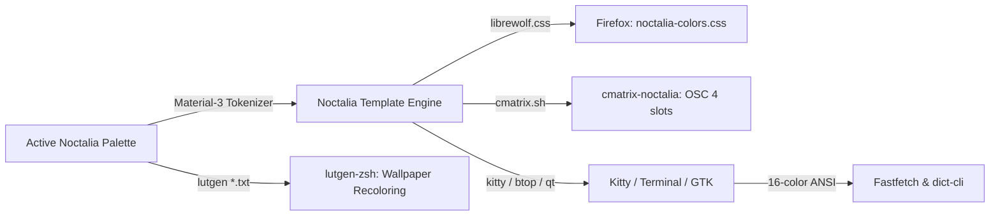

<div align="center">

```text
 █▄ █ █▀█ █▀▀ ▀█▀ ▄▀█ █▀▀ █ █   █▀▀ █▀
 █ ▀█ █▄█ █▄▄  █  █▀█ █▀  █ █▄▄ ██▄ ▄█
```

### The Unified Desktop & Shell Ecosystem

*A curated collection of dotfiles, rices, utilities, and theme-synchronized integrations for the Arch Linux + Noctalia + Hyprland environment.*

[](https://archlinux.org/)
[](https://wiki.hypr.land/)
[](https://docs.noctalia.dev/)
[](https://opensource.org/licenses/MIT)

</div>

---

## 🗂️ What is in this repository?

`noctafiles` unifies all personal desktop configurations, CLI tools, theme bridges, and backup workflows into a single repository:

| Folder | Name | Description | Language / Stack |
| :--- | :--- | :--- | :--- |
| [`firefox/`](./firefox) | **Firefox & Sonder Suite** | Pure 0px square corners, centered URL bar, elevated Sidebery, and the **Sonder Startpage** with live stats & 0ms Noctalia hot-reload. | CSS / WebExtension / Py |
| [`fastfetch/`](./fastfetch) | **Fastfetch Rice** | Dynamic category switcher, random logo selector, Pacman chasing ghosts bar, and categorized multi-color ASCII arts. | Bash / JSONC |
| [`dict-cli/`](./dict-cli) | **dict** | Zero-dependency lightning-fast terminal dictionary with offline cache, IPA phonetics, suggestions, and audio. | Node.js (Vanilla) |
| [`cmatrix-noctalia/`](./cmatrix-noctalia) | **cmatrix-noctalia** | Real-time desktop palette integration wrapper using terminal OSC 4 color remapping for `cmatrix`. | Bash / Template |
| [`lutgen/`](./lutgen) | **lutgen-zsh** | Interactive wallpaper recoloring utility with fzf multi-palette selector, Kitty graphics preview, and 40 custom palettes. | Zsh / Rust CLI |

---

## 🚀 Component Highlights & Quick Starts

### 🦊 1. [Firefox & Sonder Newtab Suite](./firefox)
```bash
cd firefox
./install.sh
```
- **0ms Cold Boot Theme Sync:** Uses Noctalia's user template engine (`librewolf.css`) to render `noctalia-colors.css` into browser profile `chrome/`.
- **Universal 0px Corners:** Strict rectangular aesthetic across all browser chrome elements.
- **Sidebery Elevation:** Pulls `#sidebar-box` up by 36px so container and settings icons sit flush on the top navbar, with tabs starting cleanly at the content line.
- **🌌 Sonder Newtab Extension:** Minimalist dashboard with 24h clock, weather, keyboard-navigable tasks (`Shift + T`), search bangs (`!yt`, `!gh`), real-time CPU/RAM/Network stats, and **live 0ms theme hot-reloading** without refreshing the tab!

### ⚡ 2. [Fastfetch Rice](./fastfetch)
```bash
cd fastfetch
./install.sh
# Run anywhere:
fastfetch            # Picks a random distinct logo
fastfetch animals    # Filter by category (arch, animals, geometry)
fastfetch --list     # Show available logos
```
- Includes 20+ custom ASCII logos designed and balanced to match the 7–8 line system info block.
- Dynamic color tokens (`$1`–`$9`) that inherit active terminal roles.

### 📖 3. [dict-cli](./dict-cli)
```bash
cd dict-cli
./install.sh
# Lookup a word:
dict serendipity
dict epiphany -p     # Headless pronunciation playback via mpv
```
- Fast dictionary lookup with definitions, synonyms, IPA phonetics, and Datamuse spelling correction.
- Offline 100k wordlist fallback and local cache.

### 🌧️ 4. [cmatrix-noctalia](./cmatrix-noctalia)
```bash
cd cmatrix-noctalia
./install.sh
# Run matrix rain in active desktop colors:
cmatrix-noctalia
```
- Remaps curses green slots dynamically to Noctalia's `primary` and `bright` tokens via OSC 4.
- Safely traps signals on exit to restore the user's original terminal colors immediately.

### 🎨 5. [lutgen-zsh](./lutgen)
```bash
cd lutgen
./install.sh
# In your terminal:
lutgen               # Interactive wallpaper browser with Kitty previews
lutgen ~/Pictures/wallpapers
```
- Recolor wallpapers into 40+ Noctalia-matched color palettes.
- Multi-select palettes via `Tab` in `fzf` with non-destructive sequential naming (`<palette>-1.png`, `<palette>-2.png`).

---

## 🛠️ Architecture: The Noctalia Color Sync Pipeline



---

## 👤 Author

- **viyoga** ([@viyoga](https://github.com/viyoga))
- Machine: Arch Linux on Hyprland + Noctalia Shell

---

## 📜 License

All subprojects in this repository are available under the [MIT License](LICENSE).
