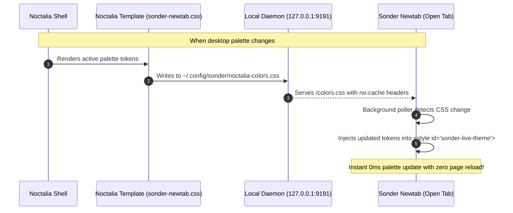

# Firefox / LibreWolf Noctalia Rice & Sonder Newtab Suite 🦊🎨

> Minimalist 0ms desktop palette-synchronized rice for Firefox and LibreWolf featuring pure 0px square corners, centered URL bar, elevated Sidebery integration, and the **Sonder Startpage** with real-time system stats and live Noctalia hot-reloading.

---

## ✨ Features

### 🦊 Browser UI Rice (`chrome/`)
- **Dynamic Noctalia Theming:**
  - Synchronizes with active Noctalia desktop palettes (dark/light/custom) via native CSS variables (`noctalia-colors.css`).
  - True 0ms cold boot: no flashing, no webextension startup lag.
- **Universal 0px Square Corners:**
  - Strict rectangular minimalism across the URL bar, dropdowns, popup menus, vertical tabs, toolbar buttons, and dialogs.
- **Centered URL Bar (720px):**
  - Truly centered across window width (`calc(50% - 360px)`), immune to Megabar breakout shift or toolbar expansion.
  - Centered idle placeholder and 1:1 aligned autocomplete dropdown results.
- **Elevated Sidebery Integration:**
  - Pulls `#sidebar-box` up by 36px to dock directly into the empty top-left navbar space.
  - Container icons and settings button sit flush on the top toolbar level, allowing tabs to start directly from the content base.
- **Clean UI Strip:**
  - Hides back/forward buttons, bookmark star, native horizontal tabs (`#TabsToolbar`), and native sidebar header.

### 🌌 Sonder Startpage Extension (`extension/`)
- **Minimalist Dashboard:**
  - 24-hour clock with live seconds, formatted date, and weather integration.
  - Hotkey speed-dials with customizable category columns (`[v]` Viyoga, `[g]` GitHub, `[r]` Reddit, `[y]` YouTube, etc.).
- **Live System Stats Monitor:**
  - Real-time CPU usage (`%`), RAM usage (`%` and used/total GB), and dynamic Download/Upload network bandwidth monitors streamed directly from Linux `/proc/`.
- **Keyboard-Navigable Task Manager:**
  - `Shift + T` toggles the interactive tasks panel.
  - `j` / `k` (or arrows) to navigate, `Space` / `x` to toggle completion, `d` / `Del` to delete, inline input to create.
- **Minimal Search Overlay:**
  - Tap `/` or start typing anywhere to summon the search overlay.
  - Instant search bangs: `!yt` (YouTube), `!gh` (GitHub), `!r` (Reddit), `!dd` (DuckDuckGo), `!w` (Wikipedia), `!m` (Maps), `!c` (Chess), `!k` (Monkeytype), and direct fallback search.
- **⚡ 0ms Live Noctalia Palette Hot-Reloading:**
  - **No refresh required:** Any open Sonder new tab dynamically recolors in real-time the instant you switch palettes or themes in Noctalia!

---

## 🏗️ Architecture: How Live Theme Hot-Reloading Works



---

## 📁 Repository Structure

```text
firefox/
├── chrome/                       # Browser UI stylesheets
│   ├── userChrome.css            # Main browser chrome styles
│   ├── userContent.css           # Internal and newtab page styling
│   └── noctalia-colors.css       # Active palette tokens (generated by Noctalia)
├── extension/                    # Sonder Startpage WebExtension (MV3)
│   ├── css/
│   │   ├── styles.css            # Startpage layout, typography, animations
│   │   └── noctalia-colors.css   # Fallback local palette tokens
│   ├── js/
│   │   └── newtab.js             # Dashboard logic, stats, tasks & live theme poller
│   ├── icons/                    # Startpage brand icons
│   ├── manifest.json             # Extension manifest
│   ├── newtab.html               # Semantic startpage markup
│   ├── package.sh                # Helper script to build sonder.xpi
│   └── sonder.xpi                # Pre-packaged, ready-to-install extension
├── daemon/                       # Local stats & theme sync daemon
│   ├── sonder-stats-server.py    # Lightweight Python server (127.0.0.1:9191)
│   └── sonder-stats.service      # Systemd user service unit
├── templates/                    # Noctalia user template sources
│   ├── librewolf.css             # Template for browser chrome (noctalia-colors.css)
│   └── sonder-newtab.css         # Template for startpage colors
├── install.sh                    # Automated all-in-one setup script
└── README.md                     # Documentation
```

---

## 🚀 Quick Setup (Automated)

The included `install.sh` automatically detects your Firefox / LibreWolf profile, installs the chrome styles, deploys the Sonder extension, configures the Noctalia templates, and enables the background stats service:

```bash
cd firefox
./install.sh
```

---

## 🛠️ Step-by-Step Manual Setup

If you prefer configuring each component manually, follow the steps below:

### 1. Configure Browser Preferences (`about:config`)

Navigate to `about:config` in Firefox or LibreWolf and configure:
1. `toolkit.legacyUserProfileCustomizations.stylesheets` ➔ **`true`** (enables `userChrome.css`).
2. *(Optional)* `svg.context-properties.content.enabled` ➔ **`true`** (allows custom SVG icon tinting).
3. If installing `.xpi` on LibreWolf / Firefox Developer Edition:
   `xpinstall.signatures.required` ➔ **`false`**.

---

### 2. Install the Browser Chrome Styles

1. Find your profile directory:
   - LibreWolf: `~/.config/librewolf/librewolf/<profile-id>.default/`
   - Firefox: `~/.mozilla/firefox/<profile-id>.default-release/`
2. Copy the files:
   ```bash
   mkdir -p <profile>/chrome
   cp firefox/chrome/userChrome.css <profile>/chrome/
   cp firefox/chrome/userContent.css <profile>/chrome/
   cp firefox/chrome/noctalia-colors.css <profile>/chrome/
   ```

---

### 3. Install the Sonder Newtab Extension

#### Method A: Permanent Profile Drop-in (Recommended)
Copy the pre-built `sonder.xpi` into your profile's `extensions/` directory:
```bash
mkdir -p <profile>/extensions
cp firefox/extension/sonder.xpi <profile>/extensions/sonder-newtab@local.ext.xpi
```

#### Method B: Load Unpacked (`about:debugging`)
1. In Firefox, navigate to `about:debugging#/runtime/this-firefox`.
2. Click **Load Temporary Add-on...**.
3. Select `firefox/extension/manifest.json`.

*(To rebuild `sonder.xpi` at any time from source, run `bash firefox/extension/package.sh`).*

---

### 4. Enable Live Stats & Theme Hot-Reload Daemon

The daemon is an ultra-lightweight, zero-dependency Python script that reads Linux `/proc/` and serves `/stats` and `/colors.css` on `127.0.0.1:9191`:

1. Install the binary:
   ```bash
   cp firefox/daemon/sonder-stats-server.py ~/.local/bin/
   chmod +x ~/.local/bin/sonder-stats-server.py
   ```
2. Install and start the systemd user service:
   ```bash
   mkdir -p ~/.config/systemd/user
   cp firefox/daemon/sonder-stats.service ~/.config/systemd/user/
   systemctl --user daemon-reload
   systemctl --user enable --now sonder-stats.service
   ```
3. Test that it is serving:
   ```bash
   curl http://127.0.0.1:9191/stats
   # Output: {"cpu": "2%", "ram": "48%", "down": "12.4 KB/s", ...}
   ```

---

### 5. Hook Noctalia Template for Dynamic Palette Switching

To make Noctalia update the startpage colors whenever you switch palettes:

1. Copy the Noctalia templates:
   ```bash
   cp firefox/templates/librewolf.css ~/.config/noctalia/templates/
   cp firefox/templates/sonder-newtab.css ~/.config/noctalia/templates/
   ```
2. Add the template declarations to `~/.config/noctalia/config.toml`:
   ```toml
   [theme.templates.user.librewolf]
   input_path = "$XDG_CONFIG_HOME/noctalia/templates/librewolf.css"
   output_path = "/path/to/profile/chrome/noctalia-colors.css"

   [theme.templates.user.sonder-newtab]
   input_path = "$XDG_CONFIG_HOME/noctalia/templates/sonder-newtab.css"
   output_path = "$HOME/.config/sonder/noctalia-colors.css"
   pre_hook = "mkdir -p $HOME/.config/sonder"
   ```
3. Reload Noctalia:
   ```bash
   noctalia msg config-reload
   noctalia msg templates-apply
   ```

Now, whenever Noctalia switches color palettes (via wallpaper, custom palette, or CLI), `~/.config/sonder/noctalia-colors.css` is immediately regenerated, the daemon serves it, and every open new tab adapts its colors **live in real time**!

---

## ⌨️ Sonder Startpage Keybinds & Cheatsheet

| Key | Action |
| :--- | :--- |
| **`/`** or typing | Open minimal search overlay |
| **`Esc`** | Dismiss search overlay or blur input |
| **`Shift + T`** | Toggle interactive task manager panel |
| **`j` / `k`** (or `↓` / `↑`) | Navigate tasks list |
| **`Space`** / **`x`** / **`Enter`** | Toggle task completed / pending |
| **`d`** / **`Delete`** | Delete selected task |
| **`Tab`** | Focus task creation input |
| **`[` + Key + `]`** | Open bookmark speed dial (e.g., `v` for viyoga, `g` for GitHub, `y` for YouTube) |

### Search Bangs
Type any of the following prefixes into the search prompt:
- `!yt <query>` ➔ Search YouTube
- `!gh <query>` ➔ Search GitHub
- `!r <query>` ➔ Search Reddit
- `!dd <query>` ➔ Search DuckDuckGo
- `!w <query>` ➔ Search Wikipedia
- `!m <query>` ➔ Search Google Maps
- `!c <query>` ➔ Search Chess.com
- `!k` ➔ Open Monkeytype
- `<plain text>` ➔ Fallback search via Google / configured engine
